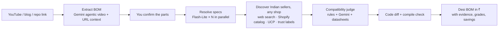

# Bharat Sourcer

## Development workspaces

- **[Backend](backend/README.md):** Python/FastAPI package, local demo job workflow, tests and backend configuration.
- **[Frontend](frontend/README.md):** reserved for the frontend teammate's app and tooling.
- **[Shared API contract](docs/contracts/README.md):** implemented endpoints and generated OpenAPI for integration.

The backend defaults to sample data without cloud credentials. It supports live YouTube extraction, grounded seller discovery, product-page verification, declared-spec compatibility checks, offer selection, parts subtotals, targeted offer refresh and optional Firestore persistence. See its README for setup and current limitations. Shipping, tax and final payable totals remain unknown.

> **Watch it in America. Build it in India.**
> Paste any maker video or blog link. Get back a parts list you can actually buy in India, priced in rupees, with a compatibility check and the exact wiring/code changes for every substitute.

Entry for the **Google Cloud AI Builder Cup 2026** (Hack2skill × Google Cloud). Theme: **Retail & Commerce**. Submission deadline: **18 Oct 2026**.

---

## ⚠️ Before anything else — eligibility

The official FAQ and T&C say:

- All team members must be **based in the JAPAC region** (UK residents are named as not eligible).
- Teams of **2–4**, all **working professionals, 21+** (no students; one student disqualifies the whole team).
- **Roster locks on 4 Oct 2026** (T&C), even though the site says team formation runs to 11 Oct.
- **All code must be written during the hackathon window.** Nothing from older repos.

Full detail and sources: [docs/01-overview/04-hackathon-strategy.md](docs/01-overview/04-hackathon-strategy.md).

---

## 60-second overview

| | |
|---|---|
| **Problem** | Most maker projects online are built in the US/UK with parts (Adafruit, SparkFun, Pololu, US mains gear) that are unavailable, 5–15× more expensive, or unsafe in India. Adapting a project means hours of digging through Quora, forums and store sites, and a wrong guess costs money and weeks. |
| **Users** | Indian students, hobbyists, Atal Tinkering Lab mentors, college robotics clubs, repair shops. |
| **Input** | A YouTube link, a blog / Instructables / Hackster / Adafruit Learn page, a GitHub repo, or an audio file. |
| **What the agents do** | Watch the video (Gemini *agentic video understanding*) → fuse evidence from video, description, code and linked pages into a BOM → resolve every part to chip + module + ecosystem → discover Indian sellers openly: no fixed store list, so new shops and deals surface automatically, trust-labelled (Google Search grounding, Shopify Global Catalog, UCP/MCP, distributor APIs, Web Risk) → grade each substitute A/B/C/D/X with deterministic electrical rules + Gemini reasoning → write the code diff and compile it → cost everything in INR incl. GST and compare to importing. |
| **Output** | A **Desi BOM**: per-part Indian buy link, price, stock, compatibility grade, "what changes" note, video timestamp evidence, safety flags; totals vs import; optional explanation read aloud in Hindi / Tamil / Malayalam; nearby electronics markets. |
| **Google stack** | Gemini 3.8 Flash, 3.5 Flash-Lite, 3.1 Pro (preview), Gemini Embedding 2, 3.8 Flash TTS, 3.5 Transcribe · Grounding with Google Search, URL context, Google Maps grounding, File Search · ADK 2.x graph workflow · Cloud Run (asia-south1) + Cloud Scheduler · Firebase Hosting, Firestore (+ vector search), Auth · Cloud Storage · Secret Manager · Web Risk · Cloud Logging/Trace. |
| **Why it wins** | 65% of the score is technical merit + innovation. This is a visible multi-agent system on brand-new Gemini capabilities, with evidence and evals, solving a real Indian problem that scales to every JAPAC country. |



---

## How to read these docs

**Skimming (10 minutes):** this README → [Executive summary](docs/01-overview/01-executive-summary.md) → [Solution & features](docs/01-overview/03-solution-and-features.md) → [Roadmap](docs/03-delivery/03-roadmap-and-timeline.md).

**Building it:** everything under [docs/02-architecture](docs/02-architecture) and [docs/03-delivery](docs/03-delivery).

**Checking a fact:** [docs/04-reference](docs/04-reference) and the raw research in [research/](research).

Full map with one line per file: **[docs/00-index.md](docs/00-index.md)**.

---

## Product documentation layout

```
bharat-sourcer/
├── README.md                     ← you are here
├── docs/
│   ├── 00-index.md               ← reading guide + file map
│   ├── 01-overview/              ← what and why (skimmable)
│   ├── 02-architecture/          ← how it works (deep)
│   ├── 03-delivery/              ← how we ship it (plan, eval, deploy, demo)
│   └── 04-reference/             ← cases, sellers, citations, glossary, decisions
└── research/                     ← raw research reports (30 Sep 2026), fully cited
```

Application workspaces now live beside `docs/`: `backend/` contains the initial API and `frontend/` is reserved for frontend work. Future `kg/`, `eval/`, and `infra/` directories are described in [the target architecture](docs/02-architecture/01-system-architecture.md#repository-layout-for-code).

---

*Docs written 30 Sep 2026. Model names, prices and limits in the Google AI stack change monthly; every such fact is dated and linked, and the day-1 verification list is in [docs/03-delivery/03-roadmap-and-timeline.md](docs/03-delivery/03-roadmap-and-timeline.md#4-day-1-verification-list).*
