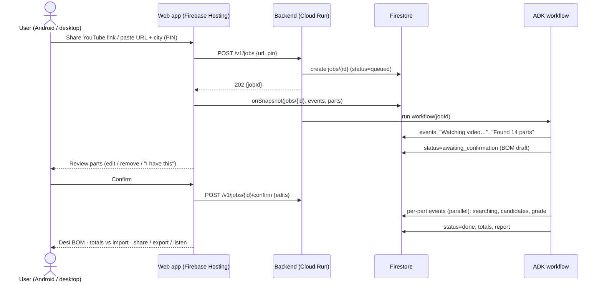

# Solution and features

> **In one minute.** One input box (or share from YouTube) produces a Desi BOM. Features are split into **Must** (MVP, demo path, GA APIs only), **Should** (stretch, after the MVP works end to end, ~day 12) and **Could** (pitch or future). The four "wow" moments are:
> - timestamp evidence for every part
> - a live multi-agent trace
> - a compatibility grade with a compiled code diff
> - the Bharat layer: mains safety, Indic voice and local markets

---

## 1. User journey (happy path)

Screen by screen:

1. **Start.** Paste box, "Paste link" button (clipboard), PIN/city (for delivery and markets), language choice. Recent public BOMs appear below as a gallery.
2. **Watching.** An embedded YouTube player and a live checklist of 5 stages. A one-line status says what the agent is doing ("Reading the description… following 3 links… watching 04:10–05:30").
3. **Confirm parts.** Draft BOM rows show a thumbnail or timestamp chip, qty and confidence. Actions per row: Edit · Remove · "I already have this". Look-alike warnings appear here ("could be a BMP280").
4. **Sourcing (live).** One card per part fills in as its agent works: sellers checked → candidates → grade chip.
5. **Desi BOM.** Grouped by seller or by part. Each row has a price, stock, grade, a "What changes" drawer and evidence. A sticky footer shows the ₹ total, the savings vs import and the time saved. Actions: Export CSV/PDF · Share link · 🔊 Explain in हिन्दी / தமிழ் / മലയാളം · Nearby markets.
6. **Row detail.** Original part vs substitute, spec diff table, wiring changes, code diff (with ✅ compiled), datasheet citations, and "verify on arrival" tests.

## 2. Feature catalogue

Effort: S ≤ 1 day, M 2–4 days, L 5+ days, assuming one developer. "Impact" is the expected judge impact, 1–5.

### 2.1 Must (MVP, demo path)

| # | Feature | What it does | Google tech | Effort | Impact |
|---|---|---|---|---|---|
| M1 | **Multi-source intake** | Classifies the URL (YouTube, Instructables, Hackster, Adafruit Learn, GitHub, generic blog). Harvests the YouTube description and links, readable page text, and GitHub code (`#include`, `platformio.ini`) | Gemini URL context; YouTube Data API `videos.list` for the description | S | 3 |
| M2 | **Agentic video BOM extraction** | Gemini watches the video goal-first and returns strict JSON: parts, qty, timestamp evidence, visible silkscreen text, look-alikes | Gemini 3.8 Flash `processing: "agentic"` (GA 1 Sep 2026); structured output | S | 5 |
| M3 | **Evidence fusion + conflict flags** | Merges mentions across sources with weighted confidence. Flags disagreements (description says BMP280, code includes `Adafruit_BME280.h`) | Deterministic Python + Flash-Lite | M | 4 |
| M4 | **Human confirmation step** | User edits the BOM before sourcing. This catches extraction errors cheaply | ADK 2.x human-input node | S | 4 |
| M5 | **Part resolution** | raw name → canonical chip + module + ecosystem + specs, using the knowledge graph first and Gemini second | Flash-Lite in parallel; Firestore KG; Embedding 2 vector search | M | 4 |
| M6 | **Open seller discovery** | No fixed store list. For every part, discovery searches the whole Indian web (grounded search), the Shopify Global Catalog (`ships_to=IN`) and distributors. Any new shop with a good deal can appear. Known sellers are a fast path, not a limit. Results are normalised to INR incl. GST | Gemini `google_search`, `url_context`; Shopify Global Catalog MCP; distributor APIs | M | 5 |
| M6b | **Auto-onboarding + trust labels** | Each unknown seller domain is probed for platform (UCP, Shopify, Woo, Magento, JSON-LD), so a new store gets structured access automatically. It's then vetted (Google Web Risk, domain age via RDAP, HTTPS, GSTIN, policies, price anomaly) and labelled *Established / Verified basics / Unverified*. Deals are labelled, never hidden | Web Risk API; Flash-Lite policy reader | M | 5 |
| M7 | **Listing verification** | Only verified listings are shown: HTTP 200, title matches chip/module, INR price parsed, stock parsed, fetched < 24 h | Cloud Run function node | S | 4 |
| M8 | **Compatibility engine** | Rules (voltage, logic level, I2C, mains, pin functions, measured quantities) + Gemini judge → grade A/B/C/D/X + ImpactReport | 3.1 Pro preview (fallback 3.8 Flash `high`); File Search over datasheets | M | 5 |
| M9 | **Code impact + compile check** | Library swap, address change, pin remap, board target → unified diff → `arduino-cli compile` (2 repair tries) | Gemini 3.8 Flash; Cloud Run job with pre-baked cores | M | 5 |
| M10 | **Costing** | Line totals, GST normalisation, shipping thresholds per seller, landed-import comparison (duty + courier estimate), savings | Python node (auditable math) | S | 4 |
| M11 | **Live agent trace UI** | Checklist + per-part cards streaming from Firestore | Firestore `onSnapshot` | S | 5 |
| M12 | **"Show me the part" evidence strip** | Timestamp chips seek the embedded YouTube player (IFrame API `seekTo`); quotes for blogs; `file:line` for code | Gemini timestamps (MM:SS) | S | 5 |
| M13 | **Safety flags** | MAINS / LIPO / HIGH_CURRENT / LEVEL_SHIFT banners, hard-coded, never LLM-only | Rules engine | S | 4 |
| M14 | **Export + share** | CSV, printable PDF, public share link (read-only) | Firestore + Hosting | S | 3 |
| M15 | **Confidence chips** | Verified / Likely / Check, plus a grade chip with text + icon (never colour alone) | — | S | 3 |

### 2.2 Should (stretch, ranked)

| # | Feature | What it does | Google tech | Effort | Impact |
|---|---|---|---|---|---|
| S1 | **Indic voice explanation** | "🔊 Explain in Malayalam" reads the build summary and wiring changes aloud; part numbers stay in English | `gemini-3.8-flash-tts` (Hindi, Tamil, Malayalam, Bengali, Telugu, Kannada, Marathi marked supported) | S | 4 |
| S2 | **Nearby electronics markets** | "Pick it up today" shows SP Road (Bengaluru), Lamington Road (Mumbai), Ritchie Street (Chennai), Lajpat Rai / Bhagirath Palace (Delhi), Broadway (Kochi), with hours and ratings; Maps attribution shown | Grounding with Google Maps (⚠️ verify India availability) | S | 4 |
| S3 | **Scan my parts bin** | A photo of the drawer marks BOM rows "✔ You have this" and removes them from cost | Gemini object detection (`box_2d`), Agentic Vision zoom | S | 4 |
| S4 | **Clip zoom-in re-read** | For low-confidence parts, re-read a 10–20 s clip at high resolution to read chip markings ("we zoomed into 03:12–03:25") | Static video mode, `start_offset`/`end_offset`, high media resolution | S | 4 |
| S5 | **Cart optimiser** | "Cheapest overall" vs "Fewest sellers", taking free-shipping thresholds into account | Python / OR-style greedy | S | 3 |
| S6 | **Visual part matching** | Embed the video frame crop and seller product images together to catch differently-titled listings | `gemini-embedding-2` + Firestore vector search | M | 4 |
| S7 | **Generative UI (A2UI)** | The agent emits declarative UI components (part card, diff widget, map card) that the React renderer draws | A2UI v0.9 React renderer; AG-UI | M | 4 |
| S8 | **Wokwi simulation badge** | Simulate patched firmware for 3–4 supported parts: "✅ Simulated: serial output OK" | Wokwi CLI / experimental MCP (not Google) | M–L | 5 |
| S9 | **Public Desi BOM library** | Every finished BOM is saved publicly and deduplicated by video; 👍/👎 "substitution worked" votes feed ranking | Firestore; Embedding 2 dedupe; Firebase Auth | M | 4 |
| S10 | **Import & carbon card** | ₹ saved, days saved, estimated shipping CO₂, % parts sourced locally | Code execution / Python | S | 3 |
| S11 | **"Verify live" button** | Browser agent opens the seller page, checks stock/price/PIN delivery, returns a screenshot, **stops before checkout** | Gemini Computer Use (preview) + Playwright on Cloud Run | M | 4 |
| S12 | **MCP server** | `source_bom(url)`, `find_indian_equivalent(part)` exposed for Gemini app, Antigravity, IDEs | Cloud Run managed remote MCP | S | 3 |
| S13 | **Audio input** | Podcast / voice-note describing a build → BOM | `gemini-3.5-transcribe` | S | 2 |

### 2.3 Could (pitch / future vision)

| # | Idea | Why it's pitch-only |
|---|---|---|
| C1 | **One-tap buy the whole BOM**: NPCI Unified Agent Protocol / UPI Reserve Pay mandate, UCP checkout with sellers, AP2 mandates over A2A | Real payments, regulation, sellers not ready. Robocraze's own `agents.md` forbids automated checkout |
| C2 | **ONDC / Beckn seller discovery** | Buyer-app onboarding (registry, signing, Pramaan certification). No public search API for a hackathon |
| C3 | **Live voice "build buddy"** in Hinglish with the camera on the workbench | `gemini-3.8-live` is GA, but pricing is unpublished and it's a risky demo |
| C4 | **WhatsApp channel** (forward a link, get the BOM + voice note) | Meta business verification time |
| C5 | **Gemma 4 on-device parts scanning** for offline labs | Android build effort |
| C6 | **Price-drop watch** | Cloud Scheduler + Flex inference. Fine later |
| C7 | **Substitution knowledge graph as a public dataset** | Community curation over time |
| C8 | **ATL lab-kit mode**: qty × N teams, GST invoice, safe-parts-only filter | Needs bulk-pricing data |
| C9b | **Nightly seller-discovery scan** (if not built in the MVP) + community "add a shop" + seller self-registration via UCP | Grows the registry without users waiting |
| C9 | **Any country**: Indonesia, Vietnam, Philippines sellers ("Build in JAPAC. Build for the world.") | The architecture already supports a `country` parameter. Only the seller adapters differ |

## 3. The four "wow" moments (what the video must show)

1. **"It watched the video for me."** The BOM appears with ▶ 03:42 chips. Tapping one jumps the player to the exact moment. Say "agentic video understanding" by name. It launched on 1 Sep 2026, so few entries will use it.
2. **"It's a team of agents, and it explores."** The trace shows 14 part-agents fanning out in parallel: "Robocraze (UCP) ✓, DigiKey (API) ✓, web search: **1 new seller discovered** (GSTIN verified, launched 3 weeks ago) — cheapest in-stock option".
3. **"It knows electronics."** The 1.3" OLED listing is really an SH1106, so the grade is **B**, with a 4-line code diff and ✅ compiled. The PowerSwitch Tail (US 120 V) gets a red **MAINS** banner and a safe 230 V alternative.
4. **"It speaks Bharat."** Tap 🔊 Malayalam and hear the wiring change explained. "Pick up today: SP Road, 2.1 km."

## 4. Non-goals

- Designing new circuits or PCBs.
- Guaranteeing live stock (we show "checked X min ago").
- Auto-purchasing or holding payment data.
- Downloading or re-hosting YouTube video (we only pass the public URL to Gemini and use the official embed).
- Non-electronics crafts in the MVP (woodworking, chemicals). 3D-printer hardware and fasteners are Should-level.
