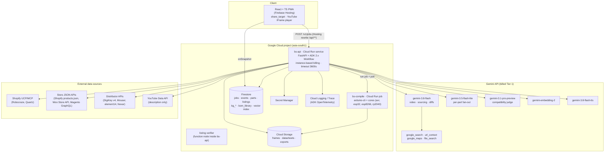
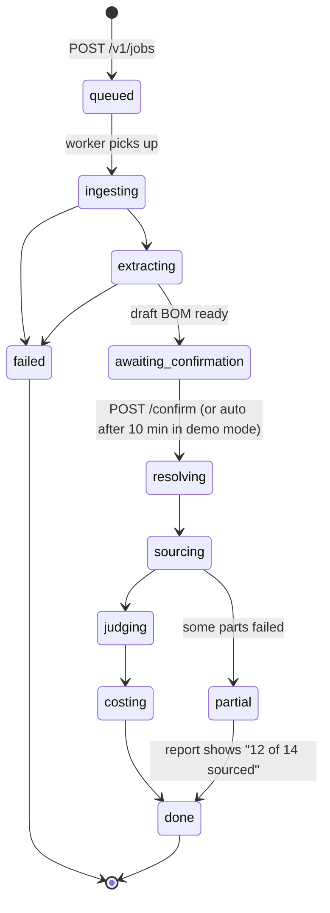

# System architecture

> **In one minute.**
> - **Frontend:** React + TypeScript SPA on Firebase Hosting. It talks to a Cloud Run backend (FastAPI + ADK 2.x graph workflow) in `asia-south1` (Mumbai).
> - **Jobs:** long analyses run asynchronously. The backend writes progress to Firestore and the UI listens with `onSnapshot`, which avoids Firebase Hosting's hard 60 s timeout and makes runs resumable and shareable.
> - **Workers:** a separate Cloud Run job compiles code diffs.
> - **State:** Firestore holds jobs, the parts cache, the knowledge graph and vectors. Cloud Storage holds frames, datasheets and exports.

---

## 1. Component diagram



## 2. Why this shape

| Decision | Reason | Alternative rejected |
|---|---|---|
| **Async job + Firestore listener** | Firebase Hosting rewrites have a **hard 60 s timeout**, and an analysis takes 1–4 min. Firestore gives live updates, resumability after a dropped connection, a shareable URL per run, and cached re-runs | Direct SSE from Cloud Run. Possible (and ADK has `/run_sse`), but not resumable and needs CORS to the raw Cloud Run URL. We keep SSE as an option for local dev |
| **One Cloud Run service for API + workflow** | Simplest for 18 days. ADK's `get_fast_api_app()` mounts into our FastAPI app | Separate worker service + Cloud Tasks: more resilient, but more moving parts. Kept as a scale-up path |
| **Instance-based billing, min-instances 1** | The workflow keeps running after the 202 response, so CPU must stay allocated. A warm instance avoids cold starts for judges | Request-based billing (CPU throttled after response) |
| **Separate compile job** | The ESP32 core is large and compiles are CPU-heavy; isolating them keeps the API image small and the API responsive | Compiling in-process |
| **`asia-south1` (Mumbai)** | Latency for Indian users; the "built for India" story. Gemini API is global either way | `us-central1` (default in docs) |
| **Gemini Developer API key (billed Tier 1)** rather than Agent Platform (ex-Vertex) | New features (Interactions API, agentic video, File Search) land here first. Grounding needs billing anyway | Agent Platform: enterprise features we don't need; ADK can switch with `GOOGLE_GENAI_USE_ENTERPRISE=True` later |
| **Firestore for everything stateful** | Free tier (1 GiB, 50k reads/day), real-time listeners, native vector search (≤ 2,048 dims) | Pinecone (not Google), Cloud SQL/AlloyDB (more ops) |

## 3. Request lifecycle



1. `POST /v1/jobs {url, pin, lang}` validates the input, computes `source_key` (e.g. `yt:VIDEO_ID`) and checks the **BOM library cache**. On a hit it returns the existing BOM (re-verifying prices older than 24 h).
2. It creates `jobs/{jobId}` with status `queued` and returns **202** with `jobId` in under 1 s.
3. It launches the ADK workflow in a background task (`asyncio.create_task`; see §5 for the durable variant). Each node writes:
   - `jobs/{id}/events/{seq}`: human-readable trace lines (agent, message, level, timestamp)
   - `jobs/{id}/parts/{lineId}`: incremental part state (extracted → resolved → candidates → graded)
   - `jobs/{id}`: status, counters, totals
4. At `awaiting_confirmation` the workflow pauses on the ADK human-input node. `POST /v1/jobs/{id}/confirm` resumes it with the user's edits.
5. Sourcing fans out per part (bounded concurrency, e.g. 8). Each part agent writes its own events.
6. Judging, code impact (which may trigger the compile job) and costing run next. Status becomes `done`, or `partial` with reasons.
7. The frontend never polls. It only listens.

## 4. Scaling and limits

| Concern | Setting |
|---|---|
| Cloud Run concurrency | ~10 per instance (LLM-bound async I/O; keeps memory predictable) |
| Max instances | 5 during the hackathon (cost guard) |
| Per-job fan-out | 8 concurrent part agents |
| Gemini rate limits | Tier 1: check actual RPM/TPM in AI Studio (⚠️ verify day 1). Exponential backoff + ADK `ReflectAndRetryModelPlugin` |
| Grounding quota | 5,000 free queries/month shared across Gemini 3.x, then $14/1k. The cache is essential |
| Firestore free tier | 50k reads / 20k writes per day. Events are batched (≤ 1 write/s per job) |
| Timeouts | Cloud Run request timeout 3600 s; per-node soft timeouts (video 120 s, per-part sourcing 45 s, judge 60 s, compile 180 s) |

## 5. Durability upgrade path (if time allows)

The in-process background task is fine for a demo, but an instance recycle kills the running job. The upgrade:

1. `POST /v1/jobs` enqueues a **Cloud Tasks** task → `POST /internal/run/{jobId}` on the same service (OIDC-authenticated).
2. Each workflow node checkpoints to Firestore (`jobs/{id}.checkpoint`) so a retried task resumes from the last completed node.
3. ADK session storage moves from in-memory to a database session service.

## 6. Environments

| Env | Where | Notes |
|---|---|---|
| `local` | `adk web` + `uvicorn` + Firestore emulator + Vite dev server | `.env` with `GOOGLE_API_KEY`; `DEMO_MODE=1` uses recorded fixtures for offline UI work |
| `dev` | Cloud Run `bs-api-dev`, Hosting preview channel | Auto-deploy from `main` |
| `prod` | Cloud Run `bs-api`, Hosting live | Deploy from tags; min-instances 1 from 15 Oct to 6 Nov |

## Repository layout for code

```
bharat-sourcer/
├── backend/
│   ├── app/                    # FastAPI app, routes, auth, job runner
│   │   ├── main.py             # get_fast_api_app() + our routers
│   │   ├── routes/jobs.py
│   │   └── firestore_sink.py   # event/part writers (batched)
│   ├── agents/                 # ADK workflow + nodes
│   │   ├── workflow.py         # graph definition
│   │   ├── intake.py  extract_video.py  extract_page.py  extract_code.py
│   │   ├── fuse.py  resolve.py  source.py  judge.py  code_impact.py  cost.py  report.py
│   │   └── prompts/            # versioned prompt files (.md)
│   ├── compat/                 # rules engine (pure Python, unit-tested)
│   ├── sourcing/               # seller adapters: ucp.py, shopify.py, woo.py, magento.py, digikey.py, mouser.py, grounded.py
│   ├── schemas/                # Pydantic models = JSON schemas for structured output
│   ├── tests/
│   └── Dockerfile
├── compile-job/                # arduino-cli image + entrypoint
├── frontend/                   # Vite + React + TS
├── kg/                         # knowledge-graph seed JSON + loader
├── eval/                       # gold BOMs, adk evalsets, metrics scripts
├── infra/                      # gcloud/firebase scripts, firestore.rules, indexes
└── docs/
```
