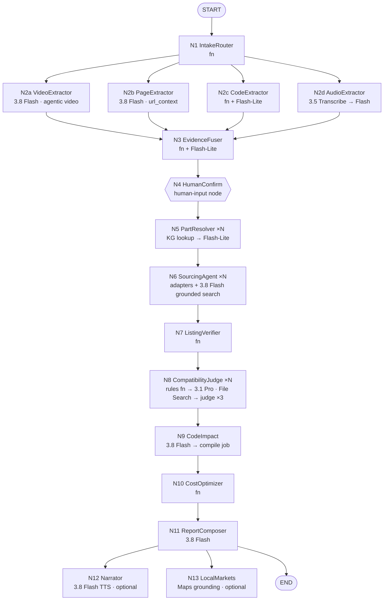

# Agent pipeline (ADK 2.x graph workflow)

> **In one minute.**
> - **Workflow:** 14 nodes, a mix of deterministic Python and Gemini agents: intake → extract (video / page / code in parallel) → fuse → **human confirm** → resolve (parallel) → source (parallel per part) → verify listings → judge → code impact (+ compile) → cost → report (+ optional voice and markets).
> - **Trace:** every node writes trace events to Firestore so the UI can show the team of agents working.
> - **Division of labour:** deterministic nodes do anything that must be exact (math, rules, verification). LLM nodes do perception, search and explanation.

---

## 1. Graph



Legend: **fn** = deterministic Python node; ×N = fan-out per BOM line with bounded concurrency (8).

## 2. Shared state

The workflow's session state is also mirrored to Firestore for the UI.

| Key | Type | Written by | Read by |
|---|---|---|---|
| `job_id`, `country` (`IN`), `pin`, `lang`, `user_level` (beginner/intermediate) | scalars | API | all |
| `sources` | `SourceBundle` (urls, texts, code files, video ref) | N1 | N2* |
| `mentions` | `RawMention[]` | N2* | N3 |
| `bom_draft` | `BomItem[]` + `conflicts[]` + `unresolved[]` | N3 | N4 |
| `bom` | confirmed `BomItem[]` (with "have it" flags) | N4 | N5 |
| `parts` | `ResolvedPart[]` | N5 | N6, N8 |
| `candidates` | `{line_id: Offer[]}` | N6 | N7 |
| `listings` | verified `Listing[]` | N7 | N8, N10 |
| `impacts` | `{line_id: ImpactReport[]}` | N8, N9 | N10, N11 |
| `costing` | `Costing` | N10 | N11 |
| `report` | `DesiBom` | N11 | API/UI |

Schemas are in [04-prompts-and-schemas.md](04-prompts-and-schemas.md).

## 3. Nodes in detail

### N1 IntakeRouter (fn)

- **Input:** `url` (or an uploaded file ref).
- **Does:**
  1. **Normalise the URL.** Unshorten `youtu.be`, `amzn.to` and `bit.ly`, and strip tracking parameters.
  2. **Classify** as `youtube | instructables | hackster | adafruit_learn | github | rnt | generic_blog | audio_upload`.
  3. **Harvest per type:**
     - **YouTube:** YouTube Data API `videos.list(part=snippet)` → title, description, channel. Extract links from the description, then follow up to 10 one hop deep if they're project pages, GitHub repos or product pages.
     - **Adafruit Learn:** fetch `…/<guide>.md?view=all`, which is clean markdown.
     - **GitHub:** fetch the tree, then README, `*.ino`, `*.cpp`, `*.h`, `platformio.ini`, `library.properties`, `*.kicad_sch` and `*.fzz` (size-capped).
     - **Everything else:** the page URL goes to N2b through URL context.
  4. Compute `source_key` (`yt:<id>`, `url:<sha1>`) for the cache.
- **Output:** `sources`.
- **Events:** "Reading the video description… 3 links found", "Found a GitHub repo with 2 sketches".
- **Failures:**
  - Private or unlisted video → fail fast with a clear message ("Gemini can only watch public videos").
  - Unreachable page → continue with the remaining sources.

### N2a VideoExtractor (LLM: `gemini-3.8-flash`)

- **Input:** YouTube URL, title, description text (as context), and a KG look-alike list for the prompt.
- **Call:** Interactions API, video part with `processing: "agentic"`, structured output `VideoBom`, `thinking_level: medium`, thought summaries on (streamed to the trace).
- **Prompt goals** (full prompt in [04-prompts-and-schemas.md](04-prompts-and-schemas.md#p2-video-extractor)):
  - Find every component shown, named or wired.
  - For each one, give:
    - **visible text verbatim** (silkscreen)
    - identity and identity confidence
    - look-alike alternatives
    - first-seen and wiring timestamps (MM:SS)
    - qty (with evidence)
    - role in the project
  - Answer `UNKNOWN` rather than guess.
  - Also return `segments[]`, e.g. "parts overview 01:10–02:30" and "wiring 05:00–07:40".
- **Stretch S4:** for items with `identity_confidence < 0.6`, run a second static call with `start_offset`/`end_offset` around the timestamp, high media resolution and 2–5 fps.
- **Output:** `RawMention[]` with `source_type=frame|transcript`.
- **Events:** "Watching video (agentic mode)…", then "Found 14 parts · 3 need a closer look".

### N2b PageExtractor (LLM: `gemini-3.8-flash` + `url_context`)

- **Input:** 1–20 URLs (the project page and linked pages).
- **Does:** reads "Parts Required", "Supplies" and "Components and supplies" sections *and prose*. For example, the DroneBot parts list says "COMING SOON!", yet the body names every part. It returns `RawMention[]` with `locator = URL#anchor` and `quote`.
- **Failures:** `url_retrieval_status` ≠ success → retry once via our own fetch (httpx + readability) passed as inline text.

### N2c CodeExtractor (fn + Flash-Lite)

- **Deterministic:**
  - regex over `#include <…>`, `import …`, `lib_deps`, `depends=`, pin `#define`s and `const int … = Dn`
  - `board =` / FQBN hints
- **Mapping:** headers → chips via the KG table (`Adafruit_BME280.h → BME280`). Unknown headers → PlatformIO registry query `header:<file>` (⚠️ verify API reachable from Cloud Run) → Flash-Lite classification.
- **Output:**
  - `LibraryEvidence[]`, which confirms chip identity but never quantity
  - `project_code` (pins used, libraries, board target), saved for N9

### N2d AudioExtractor (optional)

`gemini-3.5-transcribe` (timestamps, Indic + English code-switching) → text → same extraction prompt as N2b.

### N3 EvidenceFuser (fn + Flash-Lite)

1. **Canonicalise.** Each mention is mapped to a KG id: exact alias match, then fuzzy match, then an embedding `find_nearest` over `kg_modules`, then Flash-Lite tie-breaks.
2. **Group** mentions by canonical id.
3. **Confidence:** `conf = 1 − Π(1 − w_source × c_mention)`. Weights: code 0.9, structured page 0.85, description 0.75, transcript 0.6, frame 0.5, comment 0.3 (tuned on the eval set).
4. **Quantity:** taken from the most reliable source that states it. Disagreements go to the conflict list.
5. **Conflict rules:**
   - description chip ≠ code chip
   - look-alike pair present (BME280/BMP280, SSD1306/SH1106, DHT22/AM2302)
   - mains appliance detected
6. **Output:** `bom_draft`.
- **Event:** "Merged 31 mentions into 14 parts · 2 conflicts to check".

### N4 HumanConfirm (ADK human-input node)

- The UI shows the draft. The user can edit name/qty, remove a line, add a line, mark "I already have this", or answer quick questions ("Is the motor 6 V or 12 V?").
- `POST /v1/jobs/{id}/confirm` resumes the workflow.
- **Demo mode:** auto-confirm after N seconds so the video can run hands-free.

### N5 PartResolver ×N (KG → Flash-Lite)

1. **KG hit** (`kg_modules/{id}`): copy the specs as they are (curated, with datasheet page refs).
2. **KG miss:** Flash-Lite with URL context on the best evidence URL and the datasheet, producing `PartSpec` (category-specific attributes: HARD / SOFT / INFO; see [05-compatibility-engine.md](05-compatibility-engine.md#2-per-category-attributes)). Mark `spec_source = llm` (lower confidence).
3. **Tags:**
   - `voltage_domain` (`logic_3v3 | logic_5v | motor | mains`)
   - `safety_flags`
- **Output:** `ResolvedPart[]`.

### N6 SourcingAgent ×N (adapters + `gemini-3.8-flash` with `google_search` + `url_context`)

Sourcing is **open-world**: there's no fixed seller list. Full design in [06-sourcing-and-seller-data.md](06-sourcing-and-seller-data.md). For each part, these run in parallel:

1. **Cache:** `listings` where `module_id == X` and `fetched_at > now − 24h`. Open discovery still re-runs at least daily per module, so new sellers can enter.
2. **Open web discovery:** `SellerDiscoveryAgent` with grounded search.
   - It runs 2–4 India-biased queries with **no domain allow-list** and returns structured `Offer[]`.
   - Filters: single-product page, INR or ships to India, domain not blocklisted.
3. **Shopify Global Catalog MCP** with `ships_to=IN`. This covers any Shopify store serving India, including brand-new ones.
4. **Known-seller fast path:** structured adapters for sellers already in the `sellers` registry. Seeds and auto-discovered sellers are treated the same:
   - UCP/MCP `search_catalog`
   - Shopify JSON
   - WooCommerce Store API
   - Magento GraphQL
   - JSON-LD pages
5. **Distributors (chip-level):** DigiKey v4 KeywordSearch + **Substitutions**, Mouser Search, Nexar `similarParts` (Evaluation quota: save for demo), element14.
6. **New-seller onboarding:** runs for any unknown domain in the results, in parallel with verification. It probes the platform (`/.well-known/ucp`, Shopify, Woo, Magento, JSON-LD), then runs the trust checks: Google Web Risk, RDAP domain age, HTTPS, GSTIN, policies. The seller is added to the registry with a trust label.
7. **Candidate generation for substitutes:**
   - same chip, different module (KG)
   - footprint-compatible modules (KG)
   - family alternatives (KG)
   - DigiKey substitutions
   - embedding neighbours (S6)
- **Output:** `candidates[line_id]`.
- **Events per part:** "Robocraze (UCP): 2 matches", "Web search: 5 sellers found · 1 new seller (<new-shop>.in, GSTIN verified)", "DigiKey: 3 substitutes".

### N7 ListingVerifier (fn)

For every candidate URL (in parallel, respecting per-domain crawl-delay):

- HTTP 200, not redirected to home or search.
- Title fuzzy-contains the chip or module token (Flash-Lite as tie-breaker).
- Price parsed and normalised to **INR incl. GST** (if the site shows ex-GST, × 1.18 and mark `gst_added=true`).
- Stock parsed (`in_stock | out_of_stock | unknown`).
- Store a `Listing` with `fetched_at`, `source_tier`, `http_status` and `evidence_snippet`.
- **Only verified listings continue.** Unverified search results become "search suggestion" chips, never products.

### N8 CompatibilityJudge ×N

Full algorithm in [05-compatibility-engine.md](05-compatibility-engine.md).

1. **Rules engine (fn):** HARD-constraint checks → PASS / FIXABLE(fix) / FAIL(reason) per candidate, then a provisional grade.
2. **Rank:** grade first, then the soft score (param similarity 0.35, library overlap 0.2, ecosystem 0.15, availability 0.15, price 0.15). Keep the top 3.
3. **Explain (LLM, `gemini-3.1-pro-preview` @ high, fallback 3.8 Flash @ high):**
   - **Input:** original spec, candidate spec, the rule findings, project context (MCU logic voltage, pins used, libraries, rails), and **File Search** over datasheets and the known-substitutions notes.
   - **Output:** `ImpactReport` (wiring, power, extra parts, behaviour changes, verify-on-arrival, citations).
   - The LLM **cannot upgrade a grade** set by the rules. It can only explain or downgrade.
4. **Judge (Flash, ×3, majority):** runs the category checklist over the ImpactReport. Uncited numeric claims are stripped. Two or more failures → regenerate once, else mark `confidence=low`.
5. **Confidence** bucket: **Verified / Likely / Check manually**.

### N9 CodeImpact (LLM + compile job)

- **Triggers** when the grade is B/C/D and project code exists (from N2c).
- **Deterministic impact list:** library swap (KG `API_MAP`), I2C address change, pin remap, board target (FQBN / PlatformIO env), polarity inversion (active-LOW relays).
- **Gemini 3.8 Flash** produces a **unified diff limited to the listed impacts**.
- **Cloud Run job `bs-compile`:** `arduino-cli compile --fqbn <target>` with the needed libraries. On failure, up to 2 repair rounds feeding the compiler log back. Result: `compiled: true|false` plus the log in GCS.
- **Why:** the EmbedBench study found Arduino → ESP-IDF migration only 29.4% pass@1, and compiler feedback helps. So we **stay within the Arduino framework** and compile in the loop.
- **Stretch S8:** Wokwi simulation for supported parts.

### N10 CostOptimizer (fn)

- Chooses one listing per line. Default policy: the best grade, then the cheapest in stock.
- Adds shipping per seller using the known free-shipping thresholds:

  | Seller | Free shipping above |
  |---|---|
  | Robocraze | ₹999 |
  | Quartz | ₹500 prepaid |
  | ElectronicsComp | ₹499 |
  | Silicon TechnoLabs | ₹999 |
  | Zbotic | ₹999 |

- Two plans: **Cheapest overall** and **Fewest sellers** (a greedy consolidation that respects the thresholds).
- **Import baseline:** original US/UK price × FX (dated) + estimated international shipping + BCD 10% + SWS + IGST, with the assumptions listed ([06-cost-and-budget.md](../03-delivery/06-cost-and-budget.md) has the formula).
- **Output:** `Costing`, which includes totals, savings (₹, %), days saved (estimated) and parts sourced locally (%).

### N11 ReportComposer (3.8 Flash)

- Builds the `DesiBom`:
  - summary paragraph (plain English, level-aware)
  - per-line "what changes" in ≤ 2 sentences
  - safety banner text (templated for MAINS/LIPO, not free-form)
  - "verify on arrival" checklist
- **Optional:** A2UI component JSON (S7).
- Renders Google Search `search_suggestions` into the Sources footer (required by the ToS).

### N12 Narrator (optional, S1)

- `gemini-3.8-flash-tts` with a style prompt ("friendly lab instructor, slow, clear"). Text is generated in the target language by 3.8 Flash first, with part numbers kept in English.
- Output: audio in GCS, served via a signed URL.

### N13 LocalMarkets (optional, S2)

- `google_maps` grounding with the user's PIN/lat-lng: "electronics component shops / markets near <city> likely to stock <category list>".
- Show attribution. Phrase results as "likely to carry — call ahead".

## 4. Concurrency, timeouts, retries

| Node | Concurrency | Soft timeout | Retries |
|---|---|---|---|
| N2a video | 1 | 120 s | 1 (then fall back to static mode, 1 fps, low res) |
| N2b pages | up to 20 URLs in one call | 60 s | 1 |
| N5 resolve | 8 | 20 s/part | 1 |
| N6 source | 8 parts; within a part, adapters in parallel | 45 s/part | adapters: 2 with backoff |
| N7 verify | 16 URLs, per-domain delay | 10 s/URL | 1 |
| N8 judge | 4 | 60 s/part | 1 regenerate |
| N9 compile | 2 jobs | 180 s | 2 repairs |

A part that exceeds its budget is marked `status: partial` with a reason. The report still completes and shows "12 of 14 sourced".

## 5. Trace events (what judges see)

Every node writes `jobs/{id}/events/{seq}`:

```json
{"seq": 42, "ts": "2026-10-12T10:31:07Z", "agent": "SourcingAgent", "part": "L07",
 "level": "info", "kind": "tool_result",
 "text": "Robocraze (UCP): 2 matches for SH1106 1.3\" I2C OLED",
 "meta": {"tier": "A", "adapter": "shopify_ucp", "ms": 812}}
```

- `kind` is one of `stage | thinking | tool_call | tool_result | warning | done`.
- `thinking` events carry Gemini thought *summaries* only.
- Writes are batched to ≤ 1 per second per job.

## 6. Pseudocode skeleton (ADK 2.x)

```python
from google.adk import Agent, Workflow
from agents import intake, extract_video, extract_page, extract_code, fuse, resolve, source, verify, judge, code_impact, cost, report

video_agent = Agent(name="VideoExtractor", model=cfg.MODEL_VIDEO,
                    instruction=load_prompt("p2_video"), output_schema=VideoBom)  # or fn node calling interactions API

workflow = Workflow(
    name="bharat_sourcer",
    edges=[
        ("START", intake.run),
        (intake.run, [extract_video.run, extract_page.run, extract_code.run]),  # parallel branches
        ([extract_video.run, extract_page.run, extract_code.run], fuse.run),
        (fuse.run, "HUMAN:confirm_bom"),
        ("HUMAN:confirm_bom", resolve.run_all),        # asyncio.gather with semaphore(8)
        (resolve.run_all, source.run_all),
        (source.run_all, verify.run_all),
        (verify.run_all, judge.run_all),
        (judge.run_all, code_impact.run_all),
        (code_impact.run_all, cost.run),
        (cost.run, report.run),
    ],
)
```

The exact ADK 2.x syntax for parallel branches and human-input nodes must be checked against [adk.dev/graphs](https://adk.dev/graphs/) on day 1. If graph fan-out is awkward, wrap the fan-out in a single function node using `asyncio.gather`.
