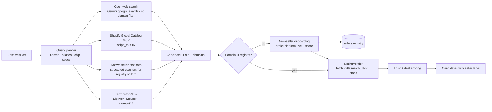

# Sourcing and seller data

> **In one minute.** Sourcing is **open-world**: there's no fixed list of stores. A shop that launched last week with a good deal should show up in results.
>
> Four parts make that work:
> - **Discovery:** search queries run on every analysis, plus a nightly scan, and they surface *any* Indian seller. Google Search grounding, the Shopify Global Catalog (`ships_to=IN`), `/.well-known/ucp` probes and Maps grounding for physical shops all feed it.
> - **Automatic platform detection:** a new Shopify, WooCommerce, Magento or UCP store gets structured, reliable access automatically, with no hand-written adapter.
> - **Trust scoring:** new sellers are labelled, not hidden. Scores come from Google Web Risk, domain age, GSTIN, policies and price-anomaly checks.
> - **The listing verifier:** nothing is shown until its product page has been fetched and checked.
>
> Known stores (Robocraze, Robu, Quartz…) are only a *seed* that speeds things up and adds quality. They are never a limit.

Seller-by-seller reference for the seed set: [../04-reference/02-india-sellers-and-apis.md](../04-reference/02-india-sellers-and-apis.md).

---

## 1. Design principle: open discovery, earned trust

| Old idea (rejected) | New design |
|---|---|
| Search an allow-list of ~20 domains | Search the **whole Indian web** for each part. Any domain can become a seller |
| Hand-written adapter per store | **Detect the platform** (UCP, Shopify, WooCommerce, Magento, JSON-LD) and pick a generic adapter automatically |
| Unknown seller means excluded | Unknown seller means **shown with a trust label**. The user decides; we make the risk visible |
| Seller list edited by us | A **seller registry grows by itself** through discovery. We only maintain a *blocklist* (scams, non-India, non-retail) |

Why: new shops, flash deals and niche specialists (a pancake NEMA17 specialist, a new FPV shop) are exactly what makers can't find manually. Discovering them is part of the product's value, and it's a good "the agent explores the world" story for judges.

## 2. Pipeline



All discovery channels run in parallel per part. A cache hit (< 24 h) short-circuits the whole chain.

## 3. Discovery channels

### 3.1 Open web search (primary discovery)
- **Agent:** `SellerDiscoveryAgent` (Gemini 3.8 Flash) with `google_search` + `url_context`, structured output `Offer[]` (prompt P4). It's wrapped as an `AgentTool` because of ADK's built-in-tool constraint.
- **No domain allow-list.** The query planner writes 2–4 India-biased queries per part:
  - `"<part name>" buy India price`
  - `"<chip> module" ₹`
  - `"<alias>" online India`
  - a Hindi or transliterated variant for common parts (optional)
- **Filters instead of an allow-list:**
  - the page must be a single-product page, not a category, search, blog or forum page
  - the currency must be INR, or the page must state that it ships to India
  - the domain must not be on the blocklist (known scams, foreign-only marketplaces such as amazon.com or aliexpress.com, pure comparison or affiliate spam)
  - Google's `search_suggestions` are rendered in the Sources footer (ToS)
- **Freshness:** Google's index surfaces new product pages within days. A shop launched last week with indexed product pages will appear. When the query planner detects "deal" intent, a follow-up query adds recency words ("new", "launch", "2026").

### 3.2 Shopify Global Catalog MCP
- `https://catalog.shopify.com/api/ucp/mcp` searches "across the entire Shopify ecosystem" with filters for availability, price and `ships_to`/`ships_from`.
- `ships_to=IN` (and optionally `ships_from=IN`) returns products from **any** Shopify store serving India, including one that opened yesterday. It doesn't depend on Google having indexed the store yet.
- Every request needs our UCP agent profile (`meta.ucp-agent.profile`).
- ⚠️ Verify coverage and rate limits on day 1 (V8).

### 3.3 Protocol probing on every new domain
When discovery surfaces an unknown domain, we probe it once (and cache the result):

| Probe | Detects | Adapter we switch on |
|---|---|---|
| `GET /.well-known/ucp` | UCP-enabled merchant (any platform) | `ucp_mcp`: `search_catalog`, `get_product` |
| `GET /robots.txt`, `/agents.md` | Agent instructions, crawl-delay, disallows | Respected by every adapter |
| `GET /products.json?limit=1`, `/search/suggest.json` | Shopify | `shopify_json` |
| `GET /wp-json/wc/store/v1/products?per_page=1` | WooCommerce Store API | `woo_store_api` |
| `POST /graphql` (introspection-free `products(search:"x")`) | Magento / Adobe Commerce | `magento_graphql` |
| JSON-LD `Product`/`Offer` on product pages | Most modern themes | `jsonld_page` (generic) |
| none of the above | Custom site | `grounded_page`: URL context + verifier only |

After probing, a newly discovered WooCommerce store gets the same structured search as Zbotic, without anyone writing code. The registry stores the detected platform, so later analyses query that seller **directly** as well as through search. This is how a new seller becomes a first-class source.

### 3.4 Nightly seller-discovery scan (background)
- **Cloud Scheduler → Cloud Run job** `bs-discover`, once a night. It uses the Batch or Flex tier (50% cheaper) where possible.
- **Queries:**
  - the top 200 most-requested modules from our own jobs ("buy ESP32 DevKit India", "TMC2209 India price"…)
  - generic seller-finding queries ("new electronics components online store India", "robotics parts shop India launch")
  - the Shopify Global Catalog for the same modules
- Every **new domain** goes through onboarding (§4). New trusted sellers are added to the registry, so the next user's search already knows them.
- **Output:** a daily "new sellers discovered" count in Cloud Logging. It's a nice deck metric: "discovered N sellers beyond our seed list".

### 3.5 Physical shops (Maps grounding, stretch S2)
- `google_maps` grounding finds shops near the user's PIN code, including newly listed Google Business Profiles.
- Shown as "likely to carry. Call ahead", with Maps attribution. These have no online price, so they're shown alongside the online BOM rather than inside it.

### 3.6 Distributor APIs (chip-level, genuine parts)
- **DigiKey v4** (KeywordSearch, **Substitutions**), **Mouser Search**, **element14**, and **Nexar `similarParts`** for demo showcases.
- These give authorised-distributor offers for ICs and genuine-brand boards, plus official substitution data.
- Limits: DigiKey ~1,000/day, Mouser 30/min and 1,000/day, Nexar Evaluation 100 matched parts/month.

### 3.7 Future discovery channels
- **ONDC / Beckn** network search would expose many small Indian sellers, but it needs buyer-app onboarding (roadmap).
- **Community submissions:** "Know a better shop? Add a link." These go through the same onboarding and verification.
- **Seller self-registration:** a seller exposes UCP, or submits their store, and gets probed automatically.

## 4. New-seller onboarding and trust scoring

Onboarding runs once per new domain and is re-checked every 30 days. It takes about 2–5 s and runs in parallel with verification, so it doesn't delay results.

### 4.1 Signals

| Signal | How | Weight idea |
|---|---|---|
| **Google Web Risk** | `uris.search` against MALWARE / SOCIAL_ENGINEERING / UNWANTED_SOFTWARE lists. Free up to 100k calls/month, then $0.50 per 1,000 ([pricing](https://cloud.google.com/web-risk/pricing)). Google-native | **Hard gate.** Any hit means blocked |
| **Domain age** | RDAP lookup. For `.in` domains: `https://rdap.nixiregistry.in/rdap/` ([IANA](https://www.iana.org/domains/root/db/in.html)). For gTLDs: the registry's RDAP via IANA bootstrap | < 30 days lowers trust; it's not a block (new shops are the point) |
| **HTTPS + valid certificate** | Fetch | Hard gate for "buy" links |
| **GSTIN shown on site** | Regex + checksum validation of the 15-char GSTIN in footer, invoice or policy pages; state code matches the stated address. ⚠️ Online verification through the GST portal has a captcha, so format and checksum only in the MVP | Strong positive |
| **Business basics** | Contact page, physical address, return/refund and shipping policy pages found (Flash-Lite reads them) | Positive |
| **Platform** | Shopify, Woo, Magento or UCP (payment-processor-backed checkout) vs unknown | Mild positive |
| **External presence** | Maps grounding hit for the business name/address; mentions on forums (Reddit, TechEnclave) via one grounded query | Positive |
| **Price anomaly** | Price < 40% of the median of verified listings for the same module | Adds an **"Unusually cheap — check seller"** flag; not a block |
| **Our own history** | 👍/👎 "order arrived / part worked" votes, report-seller button | Grows over time |
| **Blocklist** | Manual + community reports + Web Risk hits | Hard block |

### 4.2 Trust labels (shown on every offer)

| Label | Rule of thumb | UI |
|---|---|---|
| **Established** | Seed seller, or ≥ 1 year old + GSTIN + policies + positive history | Plain seller name |
| **Verified basics** | Passes Web Risk + HTTPS + GSTIN or full business basics, but new or little history | "New seller · GSTIN verified" badge |
| **Unverified** | Passes Web Risk + HTTPS, but missing GSTIN or business basics | "New & unverified seller — check before paying" + a **prefer COD** hint |
| **Blocked** | Web Risk hit, blocklist, no HTTPS, or clear scam signals | Not shown |

### 4.3 Ranking with open discovery

Deals from new sellers **can rank first**. Ranking is still grade first, then:

```
score = 0.40·price_score + 0.20·availability + 0.20·trust_score + 0.10·shipping_fit + 0.10·param_similarity
```

- When the cheapest option comes from an **Unverified** seller, the UI shows two picks side by side: "Best deal (new seller)" and "Best from an established seller". The user sees the trade-off instead of us hiding the deal.
- The cart optimiser never auto-selects an Unverified seller for the "Fewest sellers" plan, but it may for "Cheapest" with the label visible.

## 5. Listing verification (unchanged gate, now for every seller)

```python
async def verify(offer: Offer) -> Listing | None:
    seller = await registry.get_or_onboard(domain(offer.url))       # probe + trust score (cached)
    if seller.trust == "blocked": return None
    r = await fetch(offer.url, respect_robots=True, per_domain_delay=seller.crawl_delay or 1.0)
    if r.status != 200 or is_home_or_search(r.final_url): return None
    title = extract_title(r)                        # JSON-LD Product.name / og:title / h1
    if title_match(title, offer.module_guess) < 0.6: return None
    price, incl_gst = extract_price(r)              # JSON-LD offers.price → platform adapter → selectors
    if price is None or currency(r) != "INR": return None
    stock = extract_stock(r)
    inr = price if incl_gst is not False else round(price * 1.18, 2)
    return Listing(..., seller_id=seller.id, trust=seller.trust,
                   price_inr_incl_gst=inr, gst_added_by_us=(incl_gst is False), stock=stock)
```

- The **recommender only receives `listing_id`s**, and the UI renders URLs from the DB. The model never emits a user-facing URL, whether the seller is old or new.
- Stale thresholds: price 24 h, stock 6 h.

## 6. Normalisation

| Field | Rule |
|---|---|
| Price | INR incl. 18% GST. If the page states ex-GST, multiply by 1.18 and flag it. If GST status is unknown, show "GST status unclear" |
| Shipping | From the seller's shipping-policy page (Flash-Lite extracts the free-shipping threshold and flat fee at onboarding). Seed sellers have hand-checked values (e.g. Robocraze ₹999, Quartz ₹500 prepaid, ElectronicsComp ₹499). Unknown → "shipping not stated" |
| Stock | `in_stock | out_of_stock | unknown` |
| Authorised flag | From brand distributor lists (Adafruit, Pololu, Raspberry Pi) |
| Trust | From §4 |

## 7. Caching and registry

| Collection | Key | TTL / refresh |
|---|---|---|
| `sellers` | domain | platform probe 30 days; Web Risk 7 days; trust recomputed on new votes |
| `listings` | `sha1(url)` | price 24 h / stock 6 h |
| `part_offers` | `module_id + country` | 24 h, but **always re-run open discovery** at least once a day per popular module so new sellers can enter |
| `bom_library` | `source_key` | indefinite; prices and sellers re-discovered on open if older than 24 h |
| `grounding_cache` | hash(query) | 12 h (shorter than before so new sellers appear sooner) |

## 8. Cost of open discovery

- Per part, open discovery adds about 2–4 grounded queries. The known-seller fast path doesn't replace it; the two run in parallel.
- **Control levers:**
  - batch a part and its substitutes into one grounded call
  - share cached discovery results across users for the same module for 12 h
  - move broad "find new sellers" queries to the nightly job (Batch or Flex, 50% off)
  - cap at 4 queries per part
- Web Risk calls are negligible: one per new domain, free up to 100k/month.

## 9. What we will NOT do

- Automate checkout or payment (sellers' `agents.md` forbid it, and so do we).
- Scrape login-only or paywalled pages, bypass bot protection or CAPTCHAs, or ignore robots.txt or crawl-delay. This applies to new sellers too; the probe reads robots.txt first.
- Re-host seller images or descriptions.
- Use undocumented private APIs (e.g. Robu's `/api/proxy/graphql`).
- Hide a cheaper deal just because the seller is new. We label it instead.

## 10. Seed sellers (fast path, not a limit)

The seed registry starts with about 25 sellers known from research: Robocraze, Quartz, Silicon TechnoLabs, ThinkRobotics, Zbotic, Probots, Robu, Evelta, Thingbits, ElectronicsComp, Hubtronics, Robokits, FlyRobo, Sunrom, Campus Component, Ktron, Amazon.in, Flipkart, Mouser India, DigiKey India, element14 India and others.

These have hand-checked shipping thresholds, authorised-brand flags and "Established" trust. Everything else arrives through discovery. For partnerships (a data or affiliate blessing), email the top 4 seed sellers; see the decision log.
